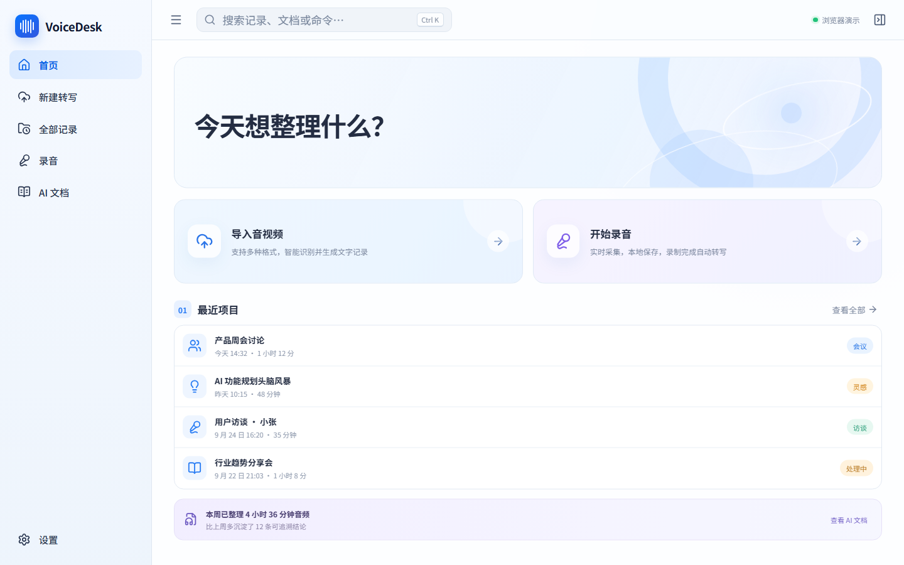
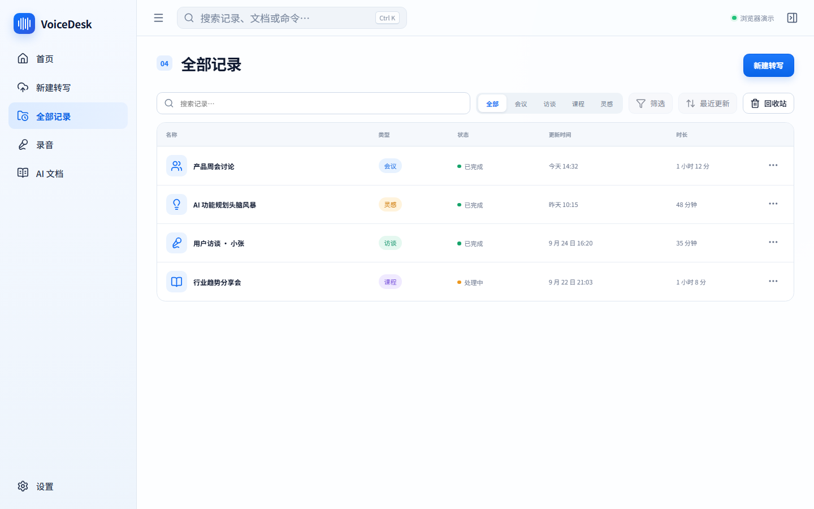
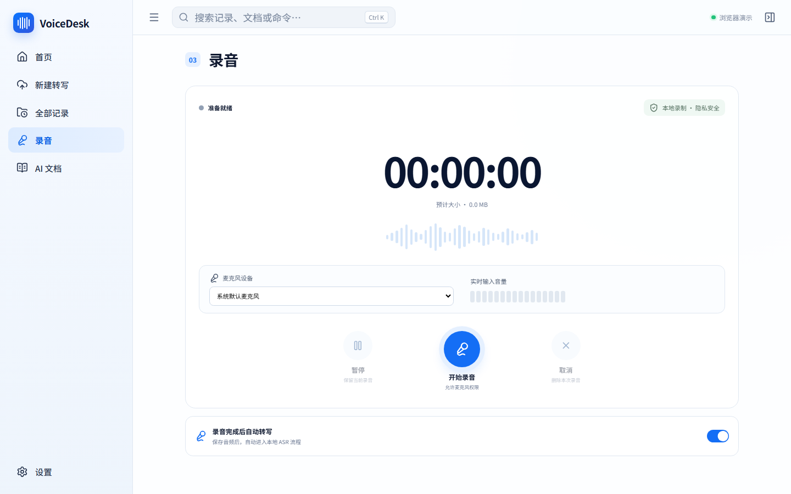
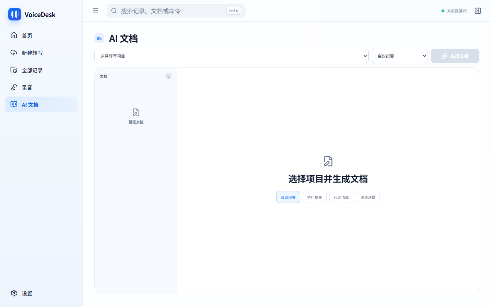
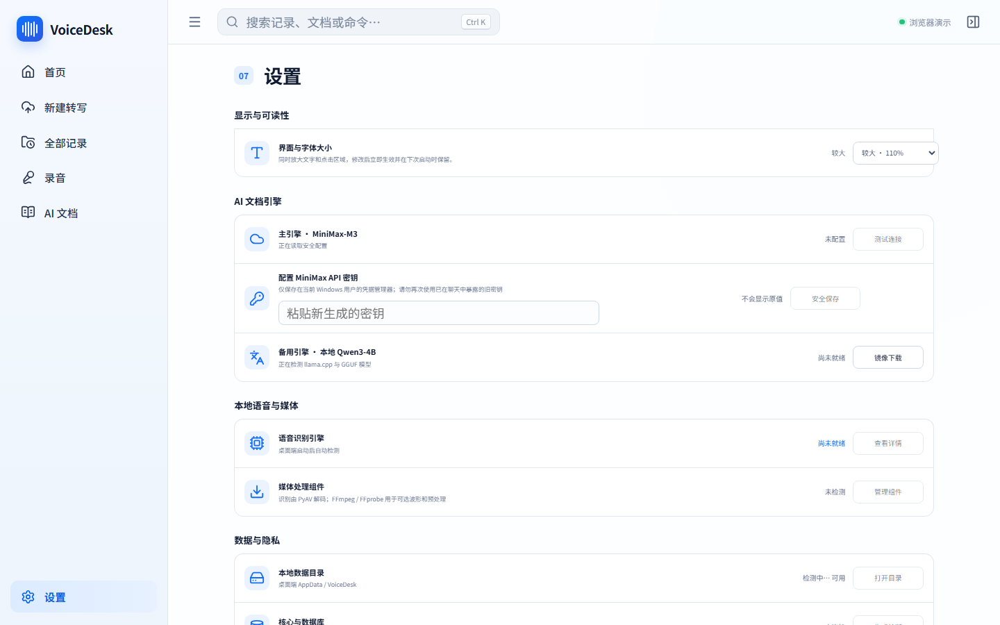
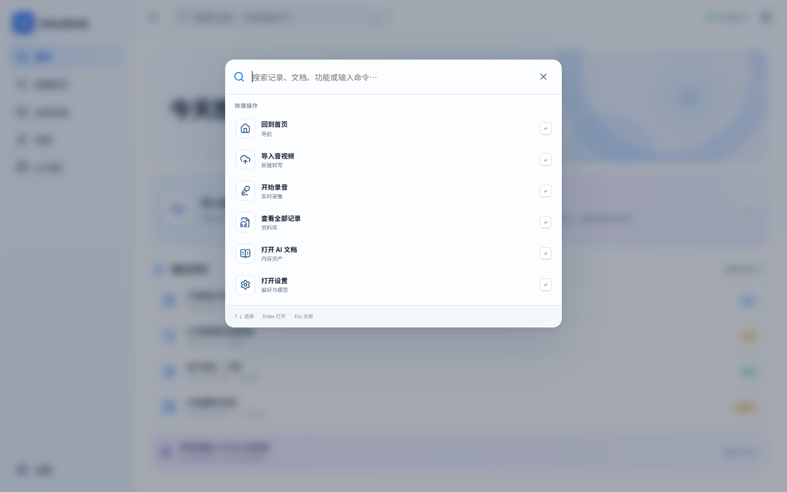
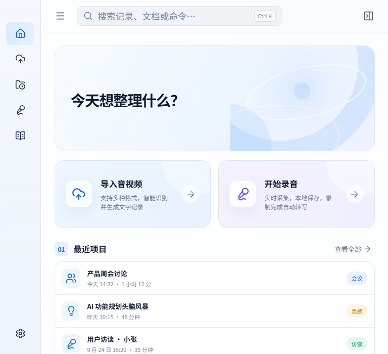

# VoiceDesk

本地优先的 Windows AI 语音工作台：录音、音视频导入、语音转文字、内容校对、章节整理和 AI 文档生成都集中在一个桌面应用中。



## 核心能力

- 本地录音与音视频批量导入
- faster-whisper / CTranslate2 本地语音识别
- 实时任务进度、失败恢复与断点续传
- 可编辑转写、全文查找替换与低置信度审核
- 音频播放、波形、时间戳跳转与说话人命名
- 自动章节、个人笔记、草稿和多格式导出
- 会议纪要、执行摘要、行动清单与访谈洞察
- MiniMax-M3 在线生成与 Qwen3 + llama.cpp 离线备用
- SQLite 本地数据存储与 Windows 凭据管理器密钥保护
- 响应式桌面布局、界面缩放与键盘命令面板

## 界面

| 记录库 | 录音 |
| --- | --- |
|  |  |

| AI 文档 | 设置 |
| --- | --- |
|  |  |

| 命令面板 | 紧凑布局 |
| --- | --- |
|  |  |

## 技术架构

```text
React 19 + TypeScript + Vite
            │
         Tauri 2
            │
Rust Core + SQLite + 可恢复任务状态机
            │
    ┌───────┴────────┐
本地 ASR Sidecar      AI 文档引擎
faster-whisper       MiniMax-M3 / Qwen3
```

VoiceDesk 面向 Windows 11 x64。音频、转写、文档和模型默认保存在本机；MiniMax API 密钥保存在 Windows 凭据管理器中，不写入项目文件或前端存储。

## 开发环境

需要：

- Windows 11 x64
- Node.js 20+
- Rust stable 与 Visual Studio C++ Build Tools
- Python 3.11 或 3.12

安装依赖并启动前端：

```powershell
npm install
npm run dev
```

初始化本地 ASR 与离线 LLM：

```powershell
npm run asr:setup
npm run llm:setup
```

启动桌面应用：

```powershell
npm run desktop:dev
```

## 构建

```powershell
npm run asr:build
npm run desktop:build
```

生成的 Windows NSIS 安装器位于：

```text
src-tauri/target/release/bundle/nsis/
```

## 验证

```powershell
npm run check
npm run build
npm run rust:check
npm run rust:test
npm run asr:test
```

当前 v0.5.0 验证基线：前端生产构建通过、11 项 Python 测试通过、12 项 Rust 测试通过，并完成 1920 / 1400 / 1000 / 700 像素窗口回归。

## 配置说明

MiniMax 密钥请仅通过应用的“设置 → AI 文档引擎”保存。不要把真实密钥写入源码、截图、Issue 或日志。

ASR 默认使用 PyAV 解码，不要求系统安装 FFmpeg。FFmpeg 仅用于可选波形与预转码，可通过系统 `PATH` 提供，也可以设置 `VOICEDESK_FFMPEG` 和 `VOICEDESK_FFPROBE`。

## 项目文档

- [个人版产品蓝图](docs/PERSONAL_PRODUCT_BLUEPRINT_V1.1.md)
- [第一阶段产品设计](docs/PHASE_1_PRODUCT_DESIGN.md)
- [第二阶段技术架构](docs/PHASE_2_ARCHITECTURE.md)
- [第三阶段 ASR Engine](docs/PHASE_3_ASR_ENGINE.md)
- [第四阶段 LLM Engine](docs/PHASE_4_LLM_ENGINE.md)
- [24 项蓝图实现状态](docs/IMPLEMENTATION_STATUS.md)
- [v0.5.0 发布审核](docs/RELEASE_AUDIT_V0.5.0.md)
- [研发 TODO](TODO.md)

## 贡献

欢迎提交 Issue 和 Pull Request。提交代码前请运行完整验证命令，并避免上传录音、转写、模型文件、API 密钥或其他个人数据。

## 开源许可证

本项目使用 [MIT License](LICENSE)。

<!-- ai-positioning:start -->
## AI / Agent / 大模型定位

- **AI 应用**：本地优先的 Windows AI 语音应用，覆盖录音、ASR、校对、章节整理和结构化文档生成。
- **Agent**：任务状态机把导入、转写、审核和文档生成编排成可恢复的桌面 Agent 工作流。
- **大模型（LLM）**：在线 MiniMax-M3 与本地 Qwen3/llama.cpp 双通道；原始音频、转写和密钥默认留在本机。

> 本节用于说明项目与 AI 的真实关系：已实现能力按现状描述，规划能力明确标注为“后续/尚未实现”。
<!-- ai-positioning:end -->
